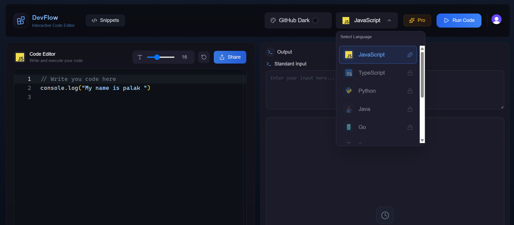
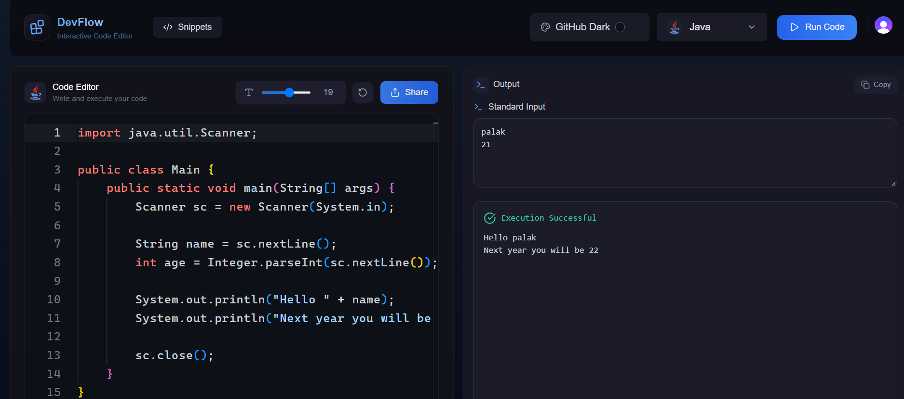

# DevFlow

### SaaS Online Development Platform

DevFlow is a full-stack SaaS platform that provides a browser-based development environment where developers can **write, run, save, and share code** from a single workspace.

Built with Next.js, TypeScript, Monaco Editor, Clerk, Convex, and an external code execution API, DevFlow combines code editing, multi-language execution, authentication, and cloud-backed snippet management into one developer-focused platform.

**Write. Run. Save. Share.**

---

### Home Page


### Code Editor


### Profile


### Snippet Management


## Features

### Code Editor

* VS Code-style editing experience powered by **Monaco Editor**
* Syntax highlighting
* Multi-language support
* Language selection
* Responsive developer-focused interface
* Real-time code execution results

### Multi-Language Code Execution

DevFlow integrates the **OnlineCompiler.io API** for executing code across multiple programming languages.

Supported languages include:

- JavaScript
- TypeScript
- Python
- C++
- Java
- C#
- Go
- Rust
- Ruby
- Swift

Features include:

- Multi-language code execution
- Standard Input (stdin) support
- Runtime output display
- Compilation and execution error handling
- Server-side API integration to securely communicate with the execution provider

The application uses a Next.js API route as an intermediary between the frontend and the external execution service, keeping provider credentials on the server side.

Code execution currently uses batch input: users provide standard input before running their programs.

### Authentication

DevFlow uses **Clerk** for user authentication and identity management.

Authenticated users can access features that require persistent user data, including snippet storage and sharing.

### Code Snippets

Users can save and share reusable code snippets through the Convex backend.

Each snippet contains:

* Title
* Programming language
* Source code
* User information
* Persistent cloud storage

Backend authentication checks ensure that protected snippet operations require an authenticated user.

### SaaS & Subscription Model

DevFlow is being developed as a **subscription-based SaaS platform**.

**Lemon Squeezy integration is used** for:

* Subscription management
* Payment processing
* Premium feature access
* Customer subscription status
* SaaS-based feature restrictions

This will allow DevFlow to evolve from a free coding workspace into a platform with optional premium developer features.


# Tech Stack

| Technology                 | Purpose                                 |
| -------------------------- | --------------------------------------- |
| **Next.js**                | Full-stack web application              |
| **React**                  | Frontend UI                             |
| **TypeScript**             | Type-safe development                   |
| **Monaco Editor**          | Browser-based code editor               |
| **Tailwind CSS**           | UI styling                              |
| **Clerk**                  | Authentication                          |
| **Convex**                 | Backend and database                    |
| **OnlineCompiler.io API**  | Multi-language code execution           |
| **Framer Motion**          | UI animations                           |
| **Lucide React**           | Interface icons                         |
| **Lemon Squeezy**          | Subscription and payment infrastructure |

# Getting Started

## Prerequisites

Make sure you have the following installed:
* Node.js
* npm
* Git
You will also need accounts/configuration for:

* Clerk
* Convex

---

## Installation

Clone the repository:

```bash
git clone https://github.com/palaksingh-06/devflow_code_editor.git
```

Navigate to the project:

```bash
cd devflow_code_editor
```

Install dependencies:

```bash
npm install
```

---

# Environment Variables

Create a `.env.local` file in the project root:

```env

NEXT_PUBLIC_CLERK_PUBLISHABLE_KEY=your_clerk_publishable_key
CLERK_SECRET_KEY=your_clerk_secret_key

NEXT_PUBLIC_CONVEX_URL=your_convex_url
NEXT_PUBLIC_CONVEX_SITE_URL=your_convex_site_url

PISTON_URL=https://api.onlinecompiler.io/api/v2/piston
ONLINECOMPILER_API_KEY=your_onlinecompiler_api_key

```

Do not commit `.env.local` or any secret credentials to the repository.

---

# Running Convex

Start the Convex development environment:

```bash
npx convex dev
```

---
## Code Execution Configuration

DevFlow uses the OnlineCompiler.io API for code execution.

Configure the following environment variables in `.env.local`:

- `PISTON_URL`
- `ONLINECOMPILER_API_KEY`

The Next.js backend forwards execution requests to the external provider and returns the execution results to the frontend.

No local Piston Docker container is required for the current execution setup.

# Running the Application

Start the Next.js development server:

```bash
npm run dev
```

Open the application at:

```text
http://localhost:3000
```

# Security Considerations

DevFlow is designed with separate frontend and backend responsibilities.

* Authentication is handled through Clerk.
* Protected snippet operations verify authentication on the backend.
* Code execution is handled through the Piston service rather than directly on the application server.
* External execution provider credentials are stored in server-side environment variables.
* Sensitive environment variables are kept outside the source code.


