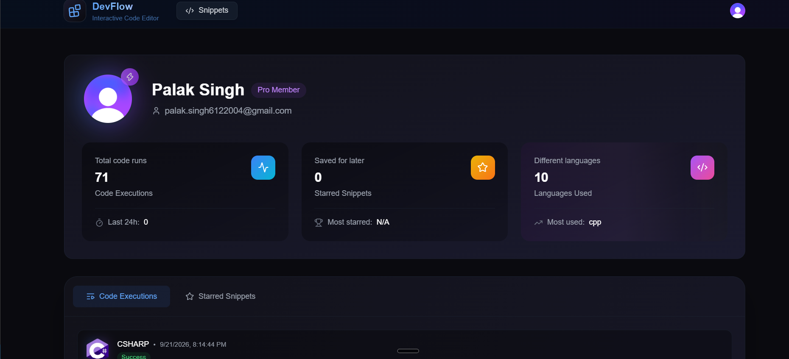
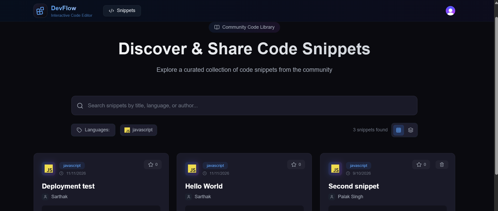

# DevFlow

### SaaS Online Development Platform

DevFlow is a full-stack SaaS development platform that provides a browser-based workspace to write, execute, save, and share code.

Built with Next.js, TypeScript, Monaco Editor, Clerk, Convex, and an external code execution API, DevFlow combines code editing, multi-language execution, authentication, and cloud-backed snippet management into one developer-focused platform.

**Write. Run. Save. Share.**

- **Live Demo:** https://devflow-seven-nu.vercel.app/
- **GitHub:** https://github.com/palaksingh-06/devflow

## Screenshots

### Home Page


### Code Editor


### Profile


### Snippet Management


## Features

### Browser-Based Code Editor

- VS Code-style editing experience powered by Monaco Editor
- Syntax highlighting and language selection
- Responsive, developer-focused interface

### Multi-Language Code Execution

DevFlow integrates the OnlineCompiler.io API to execute code in the following languages:

- JavaScript
- TypeScript
- Python
- C++
- Java
- C#
- Go
- Rust
- Ruby
- Swift

Execution features include:

- Code compilation and execution
- Standard input (stdin) supplied before execution
- Runtime output display
- Compilation and execution error handling
- A Next.js API route that forwards requests to the external execution provider

**Input model:** DevFlow currently supports batch stdin. Users enter the program's input before clicking Run. It does not currently provide an interactive terminal that accepts input while a program is running.

### Authentication and User Data

- Clerk handles user authentication and identity management.
- Convex provides backend functionality and persistent cloud data.
- Authenticated users can access protected functionality such as snippet management.

### Code Snippets

Users can save and share reusable code snippets. A snippet includes its title, programming language, source code, and associated user information.

### SaaS and Subscriptions

DevFlow includes Lemon Squeezy integration for subscription and payment-related functionality, including premium feature access. Availability of individual plan restrictions and payment flows depends on the configured product, checkout, and webhook setup.

## Tech Stack

| Technology | Purpose |
|---|---|
| Next.js | Full-stack web application and API routes |
| React | Frontend UI |
| TypeScript | Type-safe development |
| Monaco Editor | Browser-based code editor |
| Tailwind CSS | UI styling |
| Zustand | Client-side state management |
| Clerk | Authentication |
| Convex | Backend and database |
| OnlineCompiler.io API | Multi-language code execution |
| Framer Motion | UI animations |
| Lucide React | Interface icons |
| Lemon Squeezy | Subscription and payment integration |

## Getting Started

### Prerequisites

Install the following:

- Node.js
- npm
- Git

You will also need accounts and configuration for the services used by the application:

- Clerk
- Convex
- OnlineCompiler.io
- Lemon Squeezy (if you want to configure subscription/payment functionality)

### Installation

Clone the repository:

```bash
git clone https://github.com/palaksingh-06/devflow_code_editor.git
cd devflow_code_editor
```

Install dependencies:

```bash
npm install
```

### Environment Variables

Create a `.env.local` file in the project root.

The following variables are referenced by the uploaded project README:

```env
NEXT_PUBLIC_CLERK_PUBLISHABLE_KEY=your_clerk_publishable_key
CLERK_SECRET_KEY=your_clerk_secret_key

NEXT_PUBLIC_CONVEX_URL=your_convex_url
NEXT_PUBLIC_CONVEX_SITE_URL=your_convex_site_url

PISTON_URL=https://api.onlinecompiler.io/api/v2/piston
ONLINECOMPILER_API_KEY=your_onlinecompiler_api_key
```

`PISTON_URL` is a legacy variable name retained from the earlier Piston-based setup. In the current configuration described here, it points to the OnlineCompiler.io API base URL; it does not mean that a local Piston service or Docker container is required.

Keep all secret values private. Do not commit `.env.local`, API keys, webhook signing secrets, or other credentials to Git.

#### Convex environment configuration

Run the Convex development command below and follow the prompts to connect the project to a Convex deployment. Configure any backend-only environment variables required by the Convex functions in the Convex dashboard (or with the Convex CLI), rather than assuming that putting them in `.env.local` makes them available to Convex.

The exact Clerk and Lemon Squeezy webhook-secret variable names must match the names read by this project's Convex code. Confirm those names in the webhook handlers before configuring a fresh deployment; they are intentionally not guessed in this README.

### Start Convex

In one terminal, run:

```bash
npx convex dev
```

Keep this process running during local development.

### Start the Next.js Application

In another terminal, run:

```bash
npm run dev
```

Open [http://localhost:3000](http://localhost:3000) in your browser.

## Code Execution Configuration

DevFlow sends code execution requests from the frontend to a Next.js API route. The API route forwards the request to OnlineCompiler.io and returns the response to the application.

Configure these variables in the environment where the Next.js server runs:

- `PISTON_URL` — OnlineCompiler.io API base URL (legacy variable name)
- `ONLINECOMPILER_API_KEY` — API key for the execution provider

The API key must remain server-side and must not be exposed through a `NEXT_PUBLIC_` variable.

No local Piston server or Piston Docker container is required for the current execution setup.

## Deployment

### Next.js Application — Vercel

The live application is deployed at:

https://devflow-seven-nu.vercel.app/

To deploy your own instance:

1. Push the project to a Git repository.
2. Import the repository into Vercel.
3. Add the required Next.js environment variables in the Vercel project settings.
4. Ensure the Clerk, Convex, and OnlineCompiler.io configuration matches the deployment environment.
5. Deploy the application and test authentication, code execution, snippets, and any enabled subscription flows.

### Convex Backend

Convex has its own deployment and environment configuration. Use the production deployment workflow for your Convex project (for example, `npx convex deploy`) and configure the required backend environment variables for that deployment.

Make sure the production Convex deployment, Clerk configuration, and webhook endpoints/secrets are configured consistently. A Vercel deployment alone does not deploy or configure the Convex backend.

## Limitations

- **Batch stdin only:** input must be supplied before execution; interactive input during a running program is not currently supported.
- **External execution dependency:** code execution depends on the availability and response of the OnlineCompiler.io service.
- **Provider limits:** execution may be subject to the external provider's rate limits, quotas, supported runtimes, and service availability.
- **No self-hosted execution runtime:** the current setup does not run Piston locally or inside the Vercel deployment.

## Security Considerations

- Clerk is used for authentication.
- Protected snippet operations perform backend authentication checks.
- Code execution requests are forwarded through a Next.js backend route to the external execution provider.
- The provider API key is stored in server-side environment variables and is not sent to the browser.
- Webhook signing secrets and other backend credentials must be configured in the appropriate server-side or Convex environment.
- Never commit `.env.local` or other files containing secrets.


